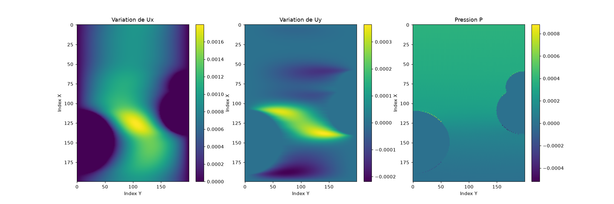
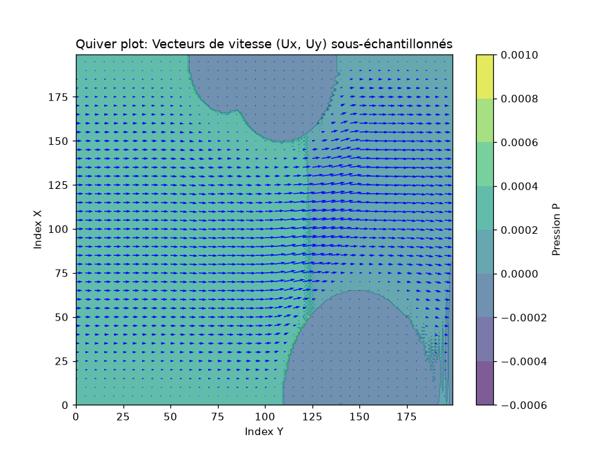
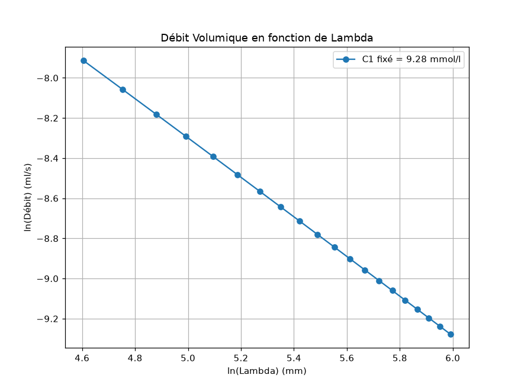
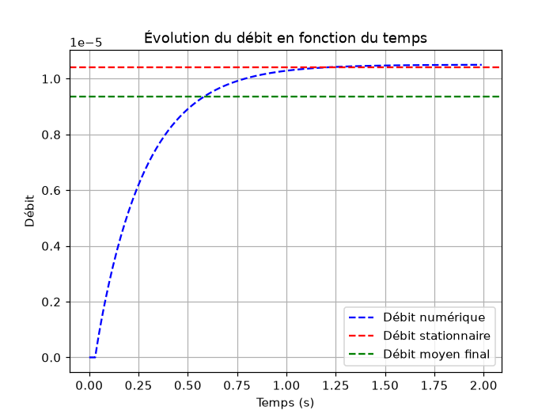

# Pulmonary Gas Exchange Modeling: 2D Diffusion and Stokes Convection

**Finite-difference simulation of oxygen transport in the lung: diffusion in a 2D acinus section and airflow in a bronchiole, in steady and transient regimes, on regular and deformed geometries, validated against analytical solutions.**


<p align="center">
  
  <br><em>Transient O<sub>2</sub> diffusion in a 2D acinus section (Crank-Nicolson), until the steady state.</em>
</p>

## Overview

Gas exchange in the lung relies on two transport mechanisms: **convection** carries air down the bronchial tree, and beyond the ~16th generation **diffusion** takes over to bring oxygen to the alveolar membrane. This project builds 2D numerical models of both mechanisms, from the simplest geometry to deformed domains and time-dependent regimes, and validates each solver against a closed-form solution before using it.

- **Context:** biomedical engineering research project at EMINES – UM6P (November 2024 – January 2025), supervised by **Prof. Marcel Filoche**.
- **Team:** eight students (Group 1).
- **My role:** as one of the eight team members, I contributed to every part of the project: steady diffusion and its analytical validation, deformed geometries and Crank-Nicolson transient diffusion, Stokes convection, and the analysis and writing of the report.

## 1. Diffusion in the acinus

### Model

Steady oxygen concentration $C(x, y)$ in a square section of side $L = 3\ \text{mm}$:

$$\nabla^2 C = \frac{\partial^2 C}{\partial x^2} + \frac{\partial^2 C}{\partial y^2} = 0$$

with three types of boundary conditions:

| Boundary | Condition | Physical meaning |
|---|---|---|
| Inlet (left) | Dirichlet: $C = C_1$ | O<sub>2</sub> concentration supplied by the airways |
| Exchange surface (right, or any wall drawn by the user) | Robin: $\dfrac{\partial C}{\partial n} = -\dfrac{C}{\Lambda}$ | Absorption through the alveolar membrane |
| Top and bottom | Neumann: $\dfrac{\partial C}{\partial n} = 0$ | No flux |

Physical parameters: $C_1 = 9.28\ \text{mol·m}^{-3}$, $D = 19.8\ \text{mm}^2\text{·s}^{-1}$, exploration length $\Lambda = 300\ \text{mm}$ (at rest).

With these conditions the problem reduces to 1D and has the closed-form solution

$$C(x) = C_1\left(1 - \frac{x}{L + \Lambda}\right)$$

which is used to validate the solver.

### Numerical scheme

Second-order 5-point stencil on a uniform grid of step $h$:

$$\frac{C_{i+1,j} + C_{i-1,j} + C_{i,j+1} + C_{i,j-1} - 4C_{i,j}}{h^2} = 0$$

Each node $(i, j)$ is mapped to a single index $k$, which turns the grid into a linear system $A\,\mathbf{C} = \mathbf{b}$. Boundary conditions are written directly into the rows of $A$:

- Neumann: the missing neighbour is removed from the stencil (e.g. $-3C_k + C_{k+n} + C_{k-n} + C_{k+1} = 0$ on the bottom wall);
- Robin, first-order: $C_k = \dfrac{\Lambda}{\Lambda + h}\, C_{k-1}$.

The diffusive flux is then $\mathbf{J} = -D\,\nabla C$. A mesh-convergence study on the balance between inflow and outflow led to $h = 0.05\ \text{mm}$.

### Deformed geometries

`diffusion_deformed.py` provides an interactive Tkinter / Matplotlib editor to carve rectangles, ellipses and polygons out of the domain and choose on which of their sides the Robin (exchange) condition applies, so as to approach the folded shape of a real acinus. The same solver is then run on the deformed grid.

### Transient diffusion: Crank-Nicolson

$$\frac{\partial C}{\partial t} = D\,\nabla^2 C$$

is discretized with the Crank-Nicolson scheme (average of the explicit and implicit Euler steps, second order in time and space):

$$\frac{C^{n+1}_{i,j} - C^{n}_{i,j}}{\Delta t} = \frac{D}{2}\left[\left(\nabla_h^2 C\right)^{n} + \left(\nabla_h^2 C\right)^{n+1}\right]$$

which gives at each time step the linear system

$$\left(I - \tfrac{D\Delta t}{2}\,L_h\right)\mathbf{C}^{n+1} = \left(I + \tfrac{D\Delta t}{2}\,L_h\right)\mathbf{C}^{n}$$

where $L_h$ is the discrete Laplacian with the boundary conditions above. Parameters: $\Delta t = 1/144\ \text{s} \approx 6.94 \times 10^{-3}\ \text{s}$, $\Delta x = 0.15\ \text{mm}$. The solution converges to the linear steady-state profile.

## 2. Convection in a bronchiole

### Model and justification

A 4th-generation bronchiole has, from the fractal scaling of the bronchial tree ($h \approx 0.79$ per generation): flow rate $Q_4 = Q_0 / 2^4 = 1.06 \times 10^{-5}\ \text{m}^3\text{/s}$, diameter $D_4 = 6.7\ \text{mm}$, length $L_4 = 49.1\ \text{mm}$. The Reynolds number is

$$Re = \frac{\rho\, U\, D_4}{\mu} \approx 0.75 \ll 1$$

so inertia is negligible and the incompressible Navier-Stokes equations reduce to the **steady Stokes equations**:

$$-\nabla P + \mu\,\nabla^2 \mathbf{u} = 0, \qquad \nabla \cdot \mathbf{u} = 0$$

with $\mu = 1.85 \times 10^{-5}\ \text{Pa·s}$, no-slip walls ($\mathbf{u} = 0$, Dirichlet), and an imposed pressure drop $\Delta P = P_1 - P_2 = 3.8 \times 10^{-4}\ \text{Pa}$ between inlet and outlet.

### Numerical scheme

The three unknowns $(u_x, u_y, P)$ are solved **simultaneously** on an $M \times N$ grid: centred second-order differences for the first derivatives, 5-point stencil for $\nabla^2$, giving one sparse system of size $3MN \times 3MN$ solved with `scipy.sparse.linalg.spsolve`.

The analytical reference is the plane Poiseuille profile in a channel of width $\ell$:

$$u_x(y) = \frac{\Delta P}{2\,\mu\,L}\; y\,(\ell - y)$$

### Deformed channels

Obstacles are carved out of the channel (no-slip on their contour). For a smooth wall deformation $f(x)$, the lubrication approximation gives an equivalent hydraulic resistance used as a reference:

$$R_{eq} = 12\,\mu \int_0^{L} \frac{dx}{\left(D - f(x)\right)^3}, \qquad Q = \frac{\Delta P}{R_{eq}}$$

### Transient flow

The time-dependent Stokes problem is integrated with an **implicit (backward) Euler** scheme: the viscous and pressure terms are evaluated at $t^{n+1}$, so each step solves a sparse system of the same structure. A periodic wall velocity $v(t) = 2\pi A f \sin(2\pi f t) - v_{\text{mucus}}$ is also used to mimic the motion of the mucus layer.

## Results

### Validation

| Test | Result |
|---|---|
| Steady diffusion vs analytical solution | relative error ~ $10^{-12}$ % |
| Mass conservation (steady diffusion) | inflow = outflow = $1.2429 \times 10^{-4}$ ml/s |
| Stokes, $u_x$ vs Poiseuille (150 × 150 grid) | relative $L^2$ error $1.18 \times 10^{-7}$ |
| Stokes, flow rate vs Poiseuille | relative error $4.5 \times 10^{-5}$ |
| Deformed channel, $f(x) = 0.001\sin(150x)$ | $Q_{num} = 9.062 \times 10^{-6}$ vs $Q_{theory} = 9.078 \times 10^{-6}\ \text{m}^2\text{/s}$ (0.2 %) |
| Deformed channel, $f(x) = 0.001\sqrt{150x}$ | $Q_{num} = 7.54 \times 10^{-6}$ vs $Q_{theory} = 7.87 \times 10^{-6}\ \text{m}^2\text{/s}$ (4 %, discretization of the wall) |

| Diffusion vs analytical solution | Stokes flow vs Poiseuille profile |
|:---:|:---:|
|  |  |

### Simulations

| Flow around obstacles ($u_x$, $u_y$, $P$) | Velocity field around obstacles |
|:---:|:---:|
|  |  |

| Flow rate vs exploration length (log-log, slope −1) | Transient flow rate converging to the steady state |
|:---:|:---:|
|  |  |

### Physical findings

- **Flux scales as $Q \propto 1/\Lambda$**: a log-log plot of the flow rate against the exploration length has a slope of −1, and the concentration at the exchange wall tends to the inlet concentration as $\Lambda \to \infty$, as predicted by the analytical solution.
- **Geometry matters**: in deformed domains the diffusive flux concentrates in narrow regions and at corners; increasing the exchange perimeter lowers the minimum concentration (from 8.9 to 8.8 mmol/L between two of the tested shapes), i.e. increases absorption.
- **Transient regime**: the flow in the bronchiole reaches the Poiseuille steady state quickly compared with a breathing cycle (~4 s), so the steady model is relevant for most of the cycle; the mucus-driven wall motion reduces the net flow rate.

## Tech stack

- **Python** · NumPy · SciPy (`sparse`, `spsolve`) · Matplotlib (fields, animations) · Pillow (GIF export) · Tkinter (geometry editor)

## Project structure

```
pulmonary-gas-exchange-modeling/
├── src/
│   ├── diffusion/
│   │   ├── diffusion_steady.py      # steady diffusion, analytical validation, Λ study
│   │   ├── diffusion_deformed.py    # interactive geometry editor + diffusion solver
│   │   └── diffusion_transient.py   # Crank-Nicolson, animation
│   └── convection/
│       ├── stokes_channel.py        # Stokes flow in a channel, Poiseuille validation
│       ├── stokes_deformed.py       # flow around obstacles
│       └── stokes_transient.py      # time-dependent flow, animation
├── docs/
│   ├── report_fr.pdf                # full report (French)
│   └── user_guide_fr.pdf            # user guide (French)
├── results/                         # figures and animations
└── requirements.txt
```

## Getting started

```bash
git clone https://github.com/ahmedlebbar/pulmonary-gas-exchange-modeling.git
cd pulmonary-gas-exchange-modeling
pip install -r requirements.txt
```

Each script is standalone and opens Matplotlib windows; animations are saved to `results/`.

```bash
python src/diffusion/diffusion_steady.py      # steady diffusion + validation
python src/diffusion/diffusion_deformed.py    # draw a deformed domain, then solve
python src/diffusion/diffusion_transient.py   # Crank-Nicolson animation

python src/convection/stokes_channel.py       # channel flow + Poiseuille validation
python src/convection/stokes_deformed.py      # flow around obstacles
python src/convection/stokes_transient.py     # transient flow animation
```

Tkinter is included in the standard Python installers for Windows and macOS (`sudo apt install python3-tk` on Ubuntu). The obstacle shape in `stokes_deformed.py` is set by the `Deff` definition at the top of the script.

## Limitations

- 2D models on simplified geometries; a real acinus is 3D and branched.
- Stokes flow only (valid for $Re \ll 1$); convection-diffusion coupling is not modelled.
- Matrices are assembled point by point in Python, so fine grids are slow to build.

## Team & acknowledgments

Biomedical Engineering Group 1, EMINES – UM6P: Samy Lakhnati, **Ahmed Lebbar**, Ayman Knadel, Mohamed Mohssine, Ali En Nouali, Sara Gherras, Mohammed Elabridi, Asmae Chabab.

Supervised by **Prof. Marcel Filoche**, whom we thank for his guidance throughout the project.

## Contact

**Ahmed Lebbar**, engineering student at EMINES – UM6P · [LinkedIn](https://www.linkedin.com/in/ahmed-lebbar/)

## License

No license: all rights reserved by the authors. The code is published for viewing only.
